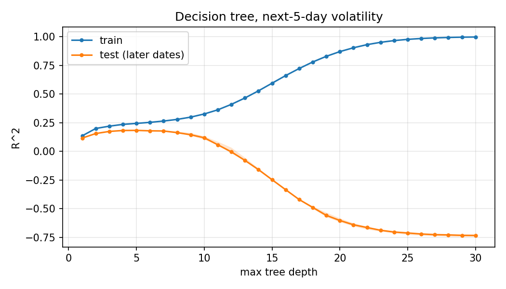

# market-data-pipeline

A pipeline for daily stock bars that runs on one machine with Docker Compose. A seeded generator fills
MySQL; a three-broker Kafka cluster carries the rows into Parquet files on a three-DataNode HDFS cluster
with exactly-once output; a gRPC service moves historical tables from MySQL to HDFS and answers per-symbol
aggregates while DataNodes die; a small Spark cluster with a Hive metastore compacts the files into a
bucketed warehouse table, trains a volatility model and answers questions asked in English; and a
three-node Cassandra cluster serves the same bars through a REST API and a gRPC tick-ingest service. All
the data is synthetic. Nothing here comes from a real market.

```
                                          +--> backfill gRPC --> Parquet exports, cache files
                                          |        (MySQL -> HDFS, survives a DataNode kill)
generator --> MySQL --> producer --> Kafka (3 brokers) --> sink --> HDFS /market/bars (Parquet)
 (seeded)    market.bars  (transactions)   market.bars.v1      (checkpoints)   |
                                                                               v
                                    Spark + Hive: compact -> market.bars (8 buckets by ticker)
                                      RDD / DataFrame / SQL, plans, caching, MLlib tree, text-to-SQL
                                                                               |
                                                    /market/serving (daily bars, monthly bars, rollups)
                                                                               v
                                       loader --> Cassandra (3 nodes, RF 3) <-- REST API (also over MySQL)
                                                          ^                 <-- gRPC tick ingest (ONE / ALL)
                                                          +-- latest quote <-- Kafka consumer
```

Stage 1 is the ingest path (MySQL, Kafka, HDFS, the backfill service), stage 2 is analytics (Spark and
Hive), stage 3 is the serving tier (Cassandra, the REST API, the ingest service). Each stage has its own
Compose file under `deploy/compose/` and its own section below. `docs/CONTRACT.md` lists what each stage
guarantees to the next: schemas, topic, HDFS paths, ports, service names and environment variables.

## Where it came from

This grew out of four projects in CS 544 (Big Data Systems) at UW-Madison, each of which exists in more than
one version with different data (home loans, weather stations, competitive-programming problems, stock
prices). P4 was a gRPC service that queried MySQL, wrote Parquet to a small HDFS cluster and answered an
aggregate from per-key cache files, surviving the loss of a DataNode. P5 was Spark and Hive: RDD, DataFrame
and SQL versions of one question, bucketing and caching, a Gemini-backed text-to-SQL function and an MLlib
decision tree. P6 was Cassandra: a Flask and MySQL stock API ported to a three-node cluster with quorum
settings chosen to survive a dead node, and a gRPC ingest service that favoured accepting writes over
consistent reads. P7 was Kafka: a producer from MySQL, and a consumer that wrote Parquet to HDFS with offset
checkpoints. (The P4 part also exists as a separate C++ implementation in
[distributed-lender-service](https://github.com/muhammad-musa-ml/distributed-lender-service).)

I rebuilt all four from scratch around one domain, daily stock bars, and joined them so that the output of
each is the input of the next. None of the course code is here. What I added:

- The pieces are connected. The Kafka sink's trusted batch files are what Spark compacts; Spark's output
  under `/market/serving` is what the Cassandra loader reads; the backfill service and the sink share one
  HDFS client and one layout module.
- Three Kafka brokers with replication 3, a producer that writes in transactions and restarts without
  repeating or skipping rows, a sink that survives being killed between its Parquet write and its
  checkpoint, and a checker that compares HDFS with MySQL row by row. Scripted drills kill brokers, sinks,
  producers and DataNodes and run the checker afterwards.
- The Hive metastore is its own service on MySQL, so tables survive restarts of every Spark process.
  Compaction reads only the sink's trusted batch files and drops duplicate ids.
- The bucketing and caching experiments are repeatable jobs. The model uses a time-based split with a gap, a
  validation block for choosing the depth, and three naive baselines.
- The text-to-SQL path validates what the model returns (one SELECT, no writes, a LIMIT), retries once with
  the error, works against Vertex AI or a local Ollama model, and is scored on 28 questions with
  hand-written gold SQL.
- The Cassandra schema comes from the queries and is a migration file applied by an init job. The loader
  reads the Spark extract with prepared statements and bounded concurrency, can be run twice without
  changing anything, and checks what it wrote against the extract's own rollups.
- One REST API runs over MySQL or Cassandra, and the same pytest file runs against both. A parity test sends
  identical requests to both and compares the answers.
- Tests stop and kill Cassandra nodes while the API and the ingest service are running and assert what
  still works. A script prints the availability table for 0, 1 and 2 dead nodes.

## The data

The generator (`src/mdp/gen`) produces 50 symbols in 8 sectors on 2 exchanges, 2600 weekday trading days
from 2014-01-06 to 2023-12-22, 130000 daily bars with seed 7. Each day's returns come from a random
generator seeded with the seed and the day index, so the series does not depend on how it was chunked or
whether the generator was restarted. The live generator continues the same series one trading day at a time.

Plain geometric Brownian motion has nothing to predict about tomorrow's volatility, and a volatility model
trained on it would have nothing to find. So a market-wide and a per-symbol log-volatility follow AR(1)
processes (persistence 0.97, half-life about 23 days) and scale each day's shocks, and volume rises with the
symbol's volatility regime. The lag-1 autocorrelation of absolute returns is about 0.15 with clustering and
about 0 without. The stage 2 model finds structure that I put into the generator on purpose. It shows that
the Spark pipeline, the split and the baselines work and says nothing about real markets.
`GEN_VOL_CLUSTERING=0` turns the clustering off and gives the earlier series bit for bit.

## Running it

You need Docker with Compose 2.20 or newer, and Python 3.11 or newer on the host for the scripts and the
unit tests (I used Docker Engine 28.4 on Docker Desktop and Python 3.13). Set up the host side once:

```
pip install -r requirements-dev.txt
python scripts/gen_proto.py
```

The whole stack at once has container limits that add up to about 16.5 GB, which does not fit in the 14.5 GiB
Docker VM I measured on. Each stage is meant to run with only the services it needs, so the steps below stop
what the next stage does not use. Everything listens on 127.0.0.1 only. On Windows with Git Bash, set
`MSYS_NO_PATHCONV=1` before commands that pass a container path such as `/app/src/...`, or the shell rewrites it.

### Stage 1: ingest (about 5.4 GB of limits)

1. `docker compose up -d --build` will build the images and start MySQL, HDFS, Kafka, the loader (which
   fills MySQL with 130000 bars and exits), the producer, the sink and the backfill service. The first start
   takes a few minutes.
2. `docker compose run --rm tools python -m mdp.check.verify` will compare HDFS with MySQL. Run it until it
   ends with `RESULT: OK`, with 130000 rows, no duplicates, gaps, extras or value mismatches.
3. Try the backfill service, which listens on 127.0.0.1:8320 (the client runs inside the network):

```
docker compose run --rm tools python -m mdp.backfill.client export --exchange NASDAQ --dest /market/exports/nasdaq.parquet
docker compose run --rm tools python -m mdp.backfill.client blocks /market/exports/nasdaq.parquet
docker compose run --rm tools python -m mdp.backfill.client summary <ticker> --source /market/exports/nasdaq.parquet
```

4. To append new bars while everything runs and watch them arrive:

```
GEN_RATE=200 docker compose --profile live up -d generator-live
docker compose --profile debug run --rm debug-consumer
```

### Stage 2: analytics (add about 6.5 GB, and stop Kafka first)

Stage 2 needs the stage 1 data in HDFS, so wait for the checker above to say OK. After that Kafka is not
needed. Stop it, start Spark next to MySQL and HDFS, and give the Docker VM 10 GB or more.

```
docker compose stop kafka-1 kafka-2 kafka-3 producer sink backfill
docker compose --profile analytics up -d --build metastore spark-master spark-worker-1 spark-worker-2 driver
docker compose exec driver spark-submit /app/src/mdp/analytics/jobs.py compact
docker compose exec driver spark-submit /app/src/mdp/analytics/jobs.py question
docker compose exec driver spark-submit /app/src/mdp/analytics/jobs.py bucketing --inflate 20
docker compose exec driver spark-submit /app/src/mdp/analytics/jobs.py caching
docker compose exec driver spark-submit /app/src/mdp/analytics/jobs.py ml
docker compose exec driver spark-submit /app/src/mdp/analytics/jobs.py serving
```

`compact` builds the `market.bars` Hive table (bucketed by ticker into 8 buckets, sorted by date), the
`market.symbols` table and a `market.daily_returns` view from the trusted batch files; its `RESULT` line
reports `rows` equal to the MySQL row count. `question` answers one question with the RDD, DataFrame and SQL
APIs and reports `"identical": true`. `bucketing` prints the physical plans of a GROUP BY and a join on a
bucketed and a plain copy; `--inflate N` stacks N shifted copies of the bars first so that timings are not
only scheduling noise. `ml` fits the decision tree, three baselines and a depth sweep from 1 to 30 and takes
several minutes. `serving` writes the extract under `/market/serving`. The Spark UI is at
http://127.0.0.1:8360.

Text-to-SQL needs a model. For Vertex AI mount your application default credentials and name a project, for
a local model run Ollama on the host:

```
export GCP_ADC_FILE=/path/to/application_default_credentials.json GOOGLE_CLOUD_PROJECT=<project>
docker compose --profile analytics up -d driver
docker compose exec driver spark-submit /app/src/mdp/analytics/jobs.py ask "How many symbols are listed on each exchange?"
docker compose exec driver spark-submit /app/src/mdp/analytics/jobs.py text2sql
docker compose exec -e OLLAMA_MODEL=<name> driver spark-submit /app/src/mdp/analytics/jobs.py text2sql --backend ollama
```

`ask` prints the SQL the model wrote and the rows it returned. `text2sql` scores the 28-question set, which
is 28 model calls and costs money on Vertex. The default model is `gemini-3.5-flash`; `MDP_SQL_MODEL` changes it.

### Stage 3: serving (add about 4.6 GB, without Spark or Kafka)

Stage 3 needs the serving extract from stage 2. Stop Spark, keep MySQL and HDFS, and start the serving
services. The Cassandra nodes join one after another, which takes a couple of minutes.

```
docker compose --profile analytics stop driver spark-worker-1 spark-worker-2 spark-master metastore
docker compose up -d mysql namenode datanode1 datanode2 datanode3
docker compose --profile serving up -d --build api-mysql api-cassandra ingest
docker compose --profile serving-tools run --rm serving-tools python -m mdp.serving.loader --backend cassandra
docker compose --profile serving-tools run --rm serving-tools python -m mdp.serving.loader --backend mysql
```

The third command also runs the init job, which creates the keyspaces `prod` and `test` (replication factor 3)
and the matching MySQL databases. Each loader run should end with
`loaded 130000 rows (50 tickers) into cassandra/prod at <n> rows/s; 0 verify problems`. Port 8400 is the API
over MySQL and 8401 the API over Cassandra; they give the same answers:

```
curl -s localhost:8401/prod/api/companies | head -c 300
curl -s -X POST localhost:8401/test/api/companies/ACME -H 'content-type: application/json' \
  -d '{"name": "Acme Corp", "sector": "Energy", "exchange": "NYSE"}'
curl -s -X PUT localhost:8401/test/api/companies/ACME/records/2024-01-02 -H 'content-type: application/json' \
  -d '{"open": 10, "high": 12, "low": 9.5, "close": 11, "volume": 5000}'
curl -s localhost:8401/test/api/companies/ACME/records/monthly
```

The endpoints and status codes are in `docs/CONTRACT.md`. The tick-ingest service listens on 127.0.0.1:8410:

```
docker compose --profile serving-tools run --rm serving-tools python -m mdp.serving.ingest_client --keyspace test probe
```

`probe` makes one write, one bulk write and one read and prints the status of each. Stop a node
(`docker stop market-data-pipeline-cassandra-2-1`) and probe again: the writes still succeed and `GetTicks`
answers `UNAVAILABLE` with "consistency ALL needs 3 replicas, 2 alive". The REST API reads and writes at
QUORUM, so with one node down it keeps working and a read still sees the write before it; with two nodes down
it answers 503. `docker start` brings the node back. Just after a node dies, the surviving nodes can take a
few seconds to mark it down, and a read at ALL in that window can end in `DEADLINE_EXCEEDED` instead.

The latest-quote consumer needs Kafka back up:

```
docker compose up -d kafka-1 kafka-2 kafka-3 kafka-init
docker compose --profile serving --profile serving-quotes up -d quotes
docker compose --profile serving-tools run --rm serving-tools python -m mdp.serving.quotes --check
```

### Tear down

```
docker compose --profile live --profile tools --profile debug --profile analytics --profile serving \
  --profile serving-tools --profile serving-quotes down -v
```

## Tests and drills

```
pytest                                    # unit tests, no containers; Spark tests are skipped without pyspark and a JDK
docker compose exec -w /app driver python3 -m pytest tests/analytics tests/test_sqlcheck.py tests/test_backends.py
python scripts/integration_test.py --faults   # fresh stage 1 stack, checker, backfill RPCs, tampering, all drills, tear down
python scripts/analytics_check.py             # stage 2 against a running stage 1 stack
python scripts/serving_test.py                # stage 3 against the extract on HDFS; --down removes the serving containers
```

Individual fault drills, each of which ends by running the checker where it applies:

```
python scripts/faults.py datanode         # kill a DataNode while the aggregate RPC is being called
python scripts/faults.py broker           # kill the broker leading partition 0 during production
python scripts/faults.py sink-crash       # crash the sink between Parquet write and checkpoint, restart, repeat
python scripts/faults.py producer-crash   # kill the producer at random moments and start it again
python scripts/serving_faults.py matrix   # which operations work with 0, 1 and 2 Cassandra nodes down
```

`scripts/serving_test.py` runs the REST suite once per backend (`integration/serving/test_api.py` has no code
that knows which backend it is talking to), the parity tests, the ingest tests, and then the ones that stop
nodes: `test_node_down.py` kills a node (and separately stops one cleanly) and checks that QUORUM writes and
the reads right after them succeed, that creating a company still works, and that with two nodes down the
API answers 503 and the refused write left nothing behind; `test_ingest_availability.py` does the 0, 1, 2
matrix for the ingest RPCs and checks that every tick acknowledged during the outage is readable at ALL
afterwards. The unit tests are CI's `unit`, `spark` and `serving` jobs.

## Results

Everything below comes from `bench/run_bench.py --final`; the raw CSVs, a `.meta.json` per file with the
command, commit and machine, and the console logs are in `bench/results/`. `bench/results/SUMMARY.md` is
generated from the CSVs by `bench/summarize.py` and has every table, including the per-question and
per-depth ones. Cells are the median over the repetitions with the minimum and maximum in brackets, and
five repetitions unless stated.

Machine: an Intel Core i7-13700HX laptop with 24 logical CPUs and 29.7 GiB of memory under Windows 11, running
Docker Desktop with a 14.5 GiB VM and 24 CPUs. Nine containers belonging to other projects were running
the whole time. Free host memory was between 1.3 and 4.3 GiB and CPU busy between 9 and 43 percent in the
snapshots I took before each stage and at the end (`bench/results/machine_state.txt`). It was not a quiet
machine, and the ranges show it. Each stage was measured with only the services it needs, one after another.
The stage 1 runs came last, so they ran on a MySQL table and an HDFS directory that the earlier stages and
the drills had already grown past the original 130000 rows.

### Correctness runs

| run | result | file |
| --- | --- | --- |
| `python scripts/integration_test.py --faults` on a fresh stack | 20 passed, 0 failed | `bench/results/correctness/stage1_integration_faults.log` |
| `kafka-init` from a cold cluster (all volumes removed each time), 5 starts | exited 0 on the first try 5 of 5 times | `kafka_init_cold.csv` |
| `python scripts/analytics_check.py` | passed | `bench/results/correctness/stage2_analytics_check.log` |
| `python scripts/serving_test.py` | all passed, on the second run | `bench/results/correctness/stage3_serving_test.log` |

The first `serving_test.py` run failed one test: with one node down, the read at ALL answered
`DEADLINE_EXCEEDED` instead of `UNAVAILABLE`, because the node I asked about had been reported down by one
surviving node but not yet by the other. The scripts now wait until every survivor reports it. That log is
kept as `stage3_serving_test_run1_failed.log`. The first `kafka-init` race that this repo once had (a fresh
cluster reporting a new topic with no partitions) happened once before it was fixed; 5 of 5 is a small sample.

### Stage 1

| what | result | file |
| --- | --- | --- |
| producer to Kafka, 130000 messages into a throwaway topic | 28,572 msgs/s (25,524 to 30,935) | `producer_throughput.csv` |
| lag from MySQL insert to the row being in a trusted HDFS file, 100 bars/s for 60 s | p50 0.84 s (0.808 to 0.915), p95 1.405 s (1.353 to 1.523) | `end_to_end_lag.csv` |
| backfill export of the NASDAQ bars (98,981 rows, 4.6 MB) | 79,025 rows/s (69,538 to 80,303) | `export_rate.csv` |
| `SymbolSummary` after killing a DataNode, time until the first correct answer for a lost cache file | 3.21 s (1.67 to 8.11); 17 to 20 cache files rebuilt; 0 errors in 30 to 60 calls per run | `datanode_recovery.csv` |
| sink killed for 10 s at 100 bars/s, then restarted | first batch 2.18 s (2.08 to 2.21) after restart, caught up 2.48 s (2.37 to 2.5), backlog about 1,520 messages | `sink_restart_recovery.csv` |

The two drills, three runs each, ending with the checker: the broker leading partition 0 was killed under
300 bars/s of production and restarted 25 seconds later (17,300 to 17,480 bars per run), and the sink was run
under a loop that makes it die between the Parquet write and the checkpoint (15 or 16 sink runs per run, 11, 13
and 9 injected crashes, the rest ended by `docker kill`; 17,780 to 18,050 bars per run). In all six runs the rows
on HDFS equalled the rows in MySQL with 0 duplicates, 0 gaps and 0 value mismatches (`fault_drills.csv`).

### Stage 2

| what | result | file |
| --- | --- | --- |
| `compact` (104 batch files into the bucketed table) | 18.3 s (16.2 to 21.9) | `analytics_job_runtime.csv` |
| `serving` (the extract) | 20.6 s (18.8 to 21.2) | same |
| the same question as RDD, DataFrame and SQL | 1.52 s, 1.16 s, 0.86 s (medians), identical answers | same |
| GROUP BY on 2.6 million rows (130000 bars stacked 20 times), bucketed | 0.282 s (0.249 to 0.422), 0 `Exchange` in the plan | `bucketing.csv`, `bucketing_plans.txt` |
| the same GROUP BY on plain files | 0.33 s (0.295 to 0.506), 1 `Exchange` | same |
| join of the table with its per-ticker average, bucketed | 1.786 s (1.568 to 2.493), 0 `Exchange` | same |
| the same join on plain files | 2.305 s (2.094 to 2.472), 2 `Exchange` | same |
| aggregation over the 2.6 million rows, not cached | 7.324 s (5.662 to 9.006) | `caching.csv` |
| the same, after caching (cache fill 16.6 s) | 0.229 s (0.185 to 0.272) | same |

The bucketed plans have no shuffle and the plain ones do, which is the point of bucketing. The timing
difference is small for the GROUP BY (the ranges overlap) and clearer for the join, about 22 percent less
time at the medians. Each figure is 5 repetitions of 3 timed runs, so n is 15.

The volatility model (3 repetitions, about 9 minutes each; the target is the mean absolute log return of the
next 5 trading days; training rows through 2021-12-29, 101,150 of them, and test rows from 2022-01-06,
25,350 of them):

| model | test R^2 |
| --- | --- |
| tree at the depth chosen on the validation block | 0.1829 (0.1827 to 0.1848); depth 4, 5, 4 in the three repetitions |
| persistence (today's trailing volatility) | 0.1084 |
| per-ticker mean | 0.0563 |
| training-set mean | -0.0112 |

The baselines do not change between repetitions because the split is fixed; the tree's depth choice does,
because depths 4 and 5 are within noise of each other. The depth sweep (`ml_depth_sweep.csv`,
`ml_depth_sweep.png`) shows the usual picture: test R^2 is about 0.17 at depth 3, 0.184 at depth 5, 0.119 at
depth 10, about 0 at depth 12 and -0.73 at depth 30, while train R^2 climbs from 0.14 at depth 1 to 0.998 at
depth 30. The most important feature is the 20-day volatility (importance 0.92).



Text-to-SQL, 28 questions with hand-written gold SQL, scored by comparing result sets:

| model | runs | correct | first try | median seconds per question |
| --- | --- | --- | --- | --- |
| Vertex AI `gemini-3.5-flash` | 3 | 28 of 28 in every run | 28 of 28 in every run | 4.58 (4.235 to 5.115) |
| Ollama `qwen3:4b-instruct-2507-q4_K_M`, local | 1 | 22 of 28 | 21 of 28 | 1.28 |

The slowest question on Vertex was `net-risers` at 24.7 s (21.4 to 31.4). The set is small and I wrote it
for this schema, so a strong model passing all of it says little; the local model's misses are in
`text2sql_runs_ollama.jsonl`. Files: `text2sql_eval_vertex.csv`, `text2sql_eval_ollama.csv`.

### Stage 3

Request latency from a Python client inside the Docker network, one request at a time, 2000 requests per
cell after 200 warm-up requests, all three nodes up (`serving_latency.csv`). "30 days" is a range read of
about 30 rows from one partition. Milliseconds, p50 / p99 as medians over the 5 repetitions:

| consistency | write | read one row | read 30 days |
| --- | --- | --- | --- |
| ONE | 0.953 / 1.94 | 1.47 / 3.219 | 1.578 / 3.792 |
| QUORUM | 1.436 / 2.882 | 1.862 / 3.686 | 1.951 / 3.956 |
| ALL | 1.354 / 3.007 | 1.772 / 3.677 | 1.868 / 3.925 |

QUORUM and ALL cost about 0.4 to 0.5 ms over ONE at the median, and on this machine all three nodes
share one disk and one kernel, so the network and replica-wait effects that would separate the levels on real
hardware are mostly absent. REST latency from the host over one connection, 1000 requests per cell,
milliseconds (`serving_api_latency.csv`):

| request | MySQL p50 / p99 | Cassandra p50 / p99 |
| --- | --- | --- |
| PUT a record | 8.899 / 15.6 | 10.6 / 15.5 |
| GET a company | 5.768 / 10.2 | 6.82 / 9.937 |
| GET 30 days of records | 8.184 / 13.8 | 10.3 / 15.6 |
| GET monthly averages over the whole history | 38.0 / 70.3 | 41.9 / 86.4 |

Loader throughput from the HDFS extract into an empty `test` database (130000 rows, write time only,
`loader_throughput.csv`):

| backend | requests in flight | rows per request | rows per second |
| --- | --- | --- | --- |
| Cassandra | 16 | 1 | 3,447 (3,354 to 3,551) |
| Cassandra | 64 | 1 | 4,242 (3,255 to 4,257) |
| Cassandra | 256 | 1 | 5,382 (5,248 to 5,592) |
| Cassandra | 64 | 50 | 44,153 (40,093 to 44,731) |
| Cassandra | 256 | 50 | 43,086 (37,795 to 43,923) |
| MySQL | 64 | 2000 | 36,439 (29,329 to 38,516) |

The unlogged single-partition batches are what make Cassandra fast here; one request per row is limited by
the Python driver and the per-request overhead.

Availability with 0, 1 and 2 of the three Cassandra nodes killed (5 attempts per cell in each of 5 runs,
so 25; `availability_matrix.csv`, `availability_matrix.md`):

| operation | consistency | 0 down | 1 down | 2 down |
| --- | --- | --- | --- | --- |
| gRPC PutTick | ONE | 25/25 | 25/25 | 25/25 |
| gRPC PutTicks (20 ticks) | ONE | 25/25 | 25/25 | 25/25 |
| gRPC GetTicks | ALL | 25/25 | 0/25, `UNAVAILABLE` | 0/25, `UNAVAILABLE` |
| REST PUT a record | QUORUM | 25/25 | 25/25 | 0/25, 503 |
| REST GET records | QUORUM | 25/25 | 25/25 | 0/25, 503 |
| REST POST a company (lightweight transaction) | QUORUM and SERIAL | 25/25 | 25/25 | 0/25, 503 |
| REST GET companies | QUORUM | 25/25 | 25/25 | 0/25, 503 |

To reproduce a figure, run the command in its `.meta.json` (the same as the ones listed in the header of
`bench/run_bench.py`), for example `python bench/run_bench.py serving-latency --reps 5 --n 2000 --warmup 200 --final`.

## Limitations

- Everything runs on one machine. "Three brokers", "three DataNodes" and "three Cassandra nodes" are
  containers that share one disk and one kernel. Failures are real container kills (SIGKILL, or a clean
  stop in some tests), but there is no network partition, no slow disk and no clock skew. With replication 3
  on three Cassandra nodes every node holds every row, so nothing here shows how the schema behaves when the
  data is spread over many nodes.
- The data is synthetic. The volatility structure is in it because I put it there, so the model result says
  something about the pipeline and nothing about markets.
- The measurements were taken on a busy laptop (see the machine notes above), five repetitions at most and
  three for the model and the drills, so treat the small differences, such as bucketed against plain
  GROUP BY, as unproven.
- The Hive schema script, `deploy/images/spark/sql/hive-schema-2.3.0.mysql.sql`, is Apache Hive's own file
  (taken from the rel/release-2.3.10 tag under the Apache License 2.0, with one line replaced; its header
  says so) and not mine. It is there because the metastore is the Hive 2.3.10 server that Spark
  bundles, and DataNucleus cannot create that schema by itself on MySQL 8 with the current connector, so
  `metastore-init` loads the script once. The metastore is old for that reason.
- On a Windows host the Cassandra Python driver cannot import: the wheels have no libev and Python 3.12 removed
  asyncore. The serving unit tests install a stand-in module in `tests/serving/conftest.py` so that they
  run on my machine; Linux (CI and the containers) loads the libev connection normally. Nothing on the host
  talks to Cassandra directly; the loader, the API and the benchmarks run in containers.
- Right after a node is killed, the survivors need some seconds to mark it down, and in that window reads at
  ALL can time out instead of answering `UNAVAILABLE`. The tests wait for every survivor to agree first.
- If the NameNode has just restarted and is still in safe mode, `docker compose up -d` can fail once because
  the loader cannot create a directory; running it again works. A fresh cluster does not have this.
- The sink writes one small Parquet file per poll batch. Stage 2 compacts them into a Hive table, but the
  small files stay and the table is rebuilt from scratch each time.
- The backfill export builds its whole result in memory, which is fine for a few hundred thousand rows. The
  producer assumes a single MySQL writer. The Spark cluster is two workers with two cores each on the same
  machine as everything else, so at 130000 rows most query time is scheduling, which is why the bucketing and
  caching timings use `--inflate`.
- The text-to-SQL question set is small, written by me, and scoring is strict about column order and extra
  columns.
- In stage 3, listing companies scans every partition and the sector filter runs in the application; the
  monthly endpoint reads every daily row of the ticker. Creating a company is a lightweight transaction while
  the loader and record writes are plain writes on the same table, which Cassandra's documentation advises
  against mixing; nothing in the API can change or delete a company or a bar, which keeps it harmless here.
  A read at ALL fails as soon as one replica is down, and that is what the ingest service is built to do.
- Prices are rounded to four places on the way in because MySQL stores `DECIMAL(12,4)`; Cassandra holds a
  double, so the rounding is what keeps the two backends identical. There is no authentication, and
  connections and passwords are plaintext development values.

## Layout

`src/mdp` is the Python package (`gen`, `stream`, `backfill`, `check`, `analytics`, `serving`, `bench`),
`proto` the protobuf contracts, `sql` the schemas and Cassandra migrations, `deploy` the Compose files, images
and environment defaults, `scripts` the drills and end-to-end checks, `bench` the benchmark runner and its
results, `tests` the unit tests and `integration` the pytest suites that need the stack.
